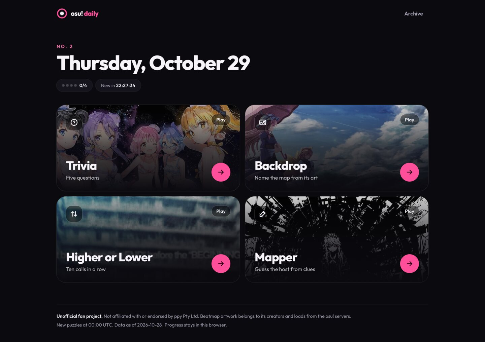
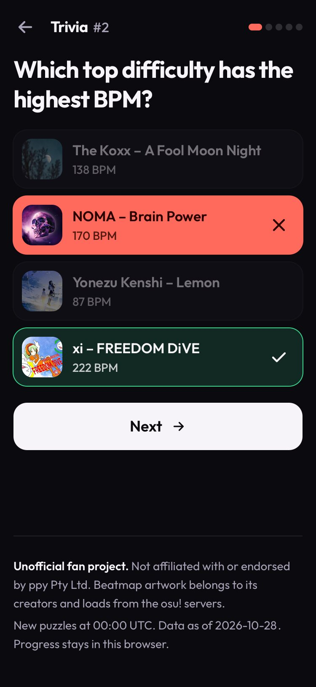
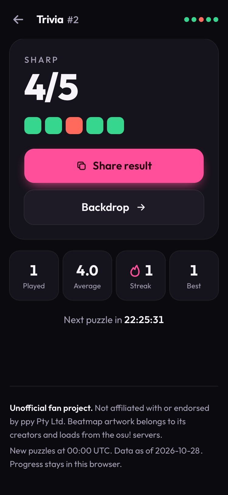
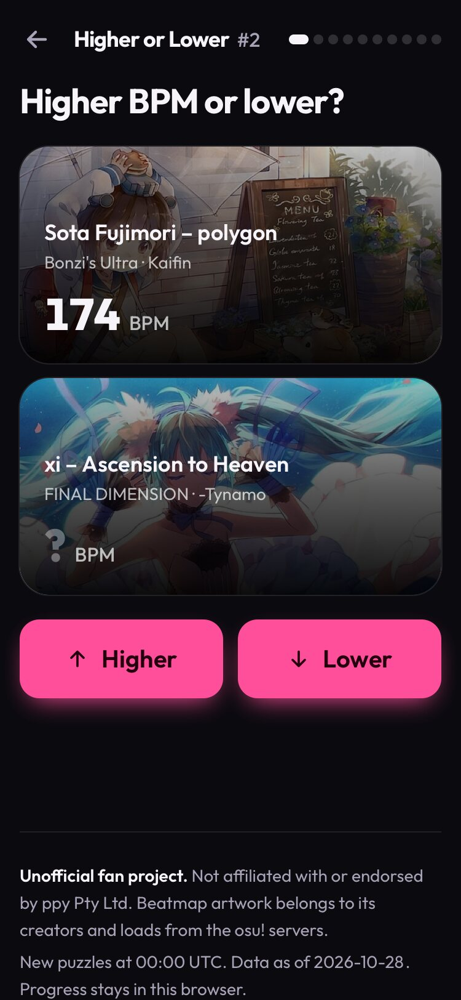
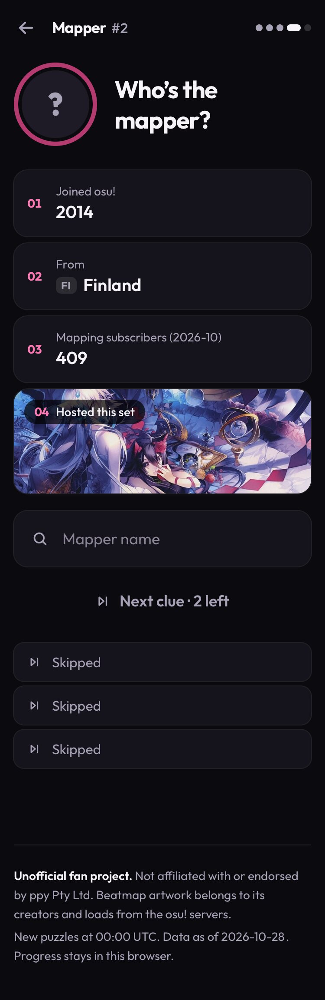

# osu! daily

Four quick osu! games, new every day. Everyone gets the same puzzles on the
same UTC day, results are saved in the browser, and finished games share as a
spoiler-free grid.



| Game | How it plays |
| --- | --- |
| **Trivia** | Five multiple-choice questions computed from beatmap data: who hosted a set, who made a song, when it was ranked, which top difficulty is fastest, longest or hardest, which set has the most plays, which song comes from a given source. |
| **Backdrop** | Name the map from its background. It starts zoomed in and blurred; every miss or skip pulls back, sharpens, and reveals a hint (year, length, BPM, mapper, artist). Six tries. |
| **Higher or Lower** | Ten calls in a row on the stat of the day: plays, favourites, BPM, length or star rating. One miss ends the run. |
| **Mapper** | Guess the set host from clues that get more specific: join year, country, mapping subscribers, a set's artwork, then a song and their initial. Five tries. |

Also: per-game streaks and stats, a countdown to the next puzzle, an archive of
past days (archive plays don't count toward streaks), and keyboard play
everywhere.

<p>
  
  
  
  
</p>

This is an unofficial fan project, not affiliated with or endorsed by ppy Pty Ltd.

## Running it

Needs Node 22.18 or newer.

```bash
npm install
npm run dev          # http://localhost:5205
npm test             # domain tests (Vitest)
npm run lint && npm run typecheck
npm run build        # static site in dist/
```

Keyboard: `1`–`4` answer Trivia and `Enter` moves on; `↑`/`↓` (or `H`/`L`) call
Higher or Lower; the answer search uses arrow keys, `Enter` and `Escape`.

## How the daily puzzles work

- **Day key.** The puzzle day is the UTC date (`YYYY-MM-DD`), so a player in
  Tokyo and one in Los Angeles see the same puzzle at the same moment. Puzzle
  #1 is 2026-10-28 (`LAUNCH_DAY` in `src/shared/daily/day.ts`).
- **Seeding.** A small seeded RNG (FNV-1a hash + mulberry32) is seeded with
  `<game>:<day>`. Backdrop, Mapper and the Higher or Lower stat walk a fixed
  shuffled rotation, so nothing repeats until the pool is used up.
- **Fairness.** Trivia questions need clearly separated answers (for example
  BPMs at least 10 apart, play counts at least 1.5× apart) and never reuse a
  set within one day. Higher or Lower only chains maps whose values differ
  enough to call. Tests check a full year of days.
- **Progress.** Every move is saved to `localStorage` under
  `osu-daily:v1:<game>`, so a closed tab resumes where it left off. Each record
  stores a puzzle signature; if a dataset update changes that day's puzzle,
  the stale progress is ignored instead of resuming a different puzzle. A
  streak counts consecutive days finished on the day itself.

## Data

`src/shared/data/dataset.json` is a curated, versioned snapshot of 92 well-known
ranked or approved osu!standard beatmapsets and their 84 hosts. It records the
hardest standard difficulty's stars, BPM and length, plus set play counts,
favourites, ranked dates and sources. Values that drift are labelled with the
snapshot date in the UI. Artwork and avatars are hot-linked from
`assets.ppy.sh` and `a.ppy.sh`, never stored here.

The list of sets lives in `data/curated-sets.json`. To refresh it from the
[osu! API v2](https://osu.ppy.sh/docs/index.html), create an OAuth application
on your osu! account settings page and run:

```bash
OSU_CLIENT_ID=… OSU_CLIENT_SECRET=… npm run data:refresh
OSU_CLIENT_ID=… OSU_CLIENT_SECRET=… npm run data:refresh -- --top 2   # also add the 100 most played ranked sets
```

The script uses client credentials with the `public` scope, stays under 60
requests a minute, keeps the most played set when a song appears twice, drops
explicit sets, and rewrites both JSON files. Review the diff before
committing: a refresh reshuffles the rotations, so future puzzles change.

## Project structure

```text
src/
  app/                  Shell, routes, footer, cross-game progress helpers
  features/
    home/               Home tiles (+ domain/tileArt: spoiler-free artwork)
    trivia/             TriviaPage, components/, domain/ (questions, puzzle, session)
    backdrop/           BackdropPage, components/, domain/ (puzzle, reveal views)
    higher-lower/       HigherLowerPage, components/, domain/ (stats, chain, session)
    mapper/             MapperPage, components/, domain/ (clues, puzzle)
    archive/            Past puzzles
  shared/
    daily/              UTC day keys, countdown, seeded RNG and rotation
    progress/           localStorage records, resume, streaks and stats
    guessing/           Rules shared by the guess-in-N games
    data/               Dataset types, bundled JSON, artwork URLs
    search/             Search-as-you-type matching
    share/              Spoiler-free share text
    components/         Buttons, layout, result card, answer search, artwork
scripts/                Dataset refresh (osu! API v2) and its transform
data/                   Curated beatmapset IDs
docs/                   Design direction, release checklist, screenshots
```

Domain modules don't import React or browser APIs, so the game rules are
tested on their own.

## Deploying

The site is static. `wrangler.jsonc` serves `dist/` as Cloudflare Worker static
assets with single-page-app fallback; `public/_headers` adds security and
caching headers. After `npx wrangler@4 login`, `npm run deploy` builds and
deploys. CI (`.github/workflows/ci.yml`) runs lint, typecheck, tests and the
build on every push and pull request. See `docs/RELEASE_CHECKLIST.md`.
